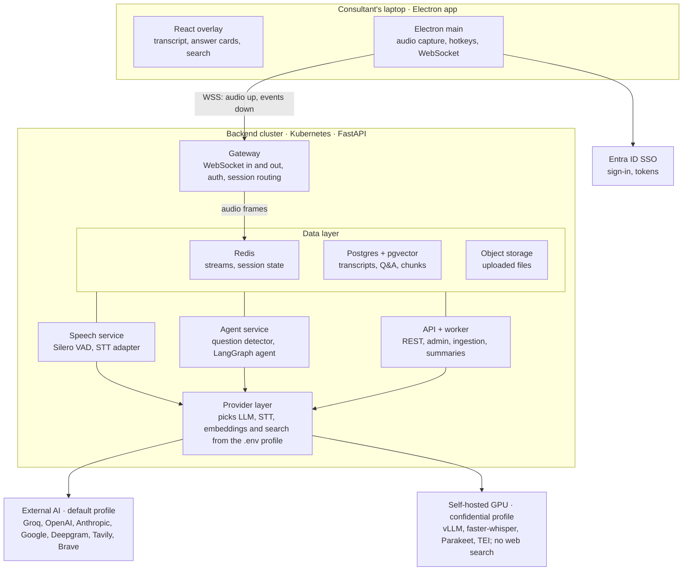
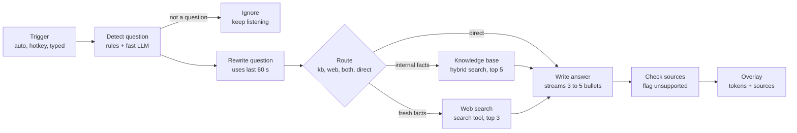
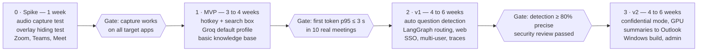

# Meeting Copilot — Production Architecture

23 October 2026 · Author: Pradeep Singh

## Summary

Meeting Copilot listens to meeting audio on the consultant's computer and streams short, sourced answers into a transparent overlay within about 2–4 seconds. Screen-share software is asked not to capture the overlay. The system is built as a multi-user production service: a FastAPI backend running a LangGraph agent, and a React overlay packaged as an Electron desktop app.

Key decisions:

- **Any model, chosen by `.env`.** The LLM, speech-to-text, embedding and web-search providers are plugins behind one interface. Switching Groq to OpenAI, Claude, Gemini or a self-hosted vLLM server is a configuration change, not a code change.
- **Real time over WebSockets.** Audio goes up and transcript, answer tokens and sources come down on one connection per meeting session.
- **Two ways to ask.** Questions are detected automatically from the client's speech, and a search button plus hotkey in the overlay lets the user type or trigger a query at any time.
- **Fast path by default.** The default answer mode is `direct`: one streaming LLM call that answers from the model's own knowledge plus a short company brief, with no retrieval, routing or web search, so the first words appear in about 1–1.5 s. Web search (`web`) and knowledge-base retrieval (`kb`) are opt-in modes: a button in the overlay or `ANSWER_MODE` in `.env`.
- **Agent, not a single prompt.** A LangGraph graph runs every answer; in `direct` mode it is a single node, and in the opt-in modes it adds search or retrieval before streaming a 3–5 bullet answer with citations.
- **Confidential mode.** Client-confidential meetings are routed only to self-hosted models, so no client data reaches an external AI service.

Constraint up front: hiding the overlay from screen capture is a best-effort request to the operating system, not a guarantee. The safe default is to share only the PowerPoint window, never the entire screen.

## Requirements

### Functional

| ID | Requirement |
| --- | --- |
| FR-1 | Capture meeting audio (system output) and the user's microphone as two separate channels, from Zoom, Teams, Google Meet or any other app. |
| FR-2 | Show a live transcript, labelled "Client" and "Me" by channel. |
| FR-3 | Detect questions from the client channel automatically and answer them without any click. |
| FR-4 | Search button and text box in the overlay: the user types a query, or presses "Answer last question" (also on a global hotkey). |
| FR-5 | Stream the answer token by token into a transparent, always-on-top overlay: 3–5 bullets, one suggested sentence to say, sources. |
| FR-6 | Answer from the company knowledge base first, from the web when needed, and say which. |
| FR-7 | Overlay controls: show/hide hotkey, opacity, click-through, drag, pin, pause listening. |
| FR-8 | After the meeting: summary, action items and the Q&A log, exportable to Outlook or Teams. |
| FR-9 | Admin: upload knowledge documents, manage users, choose models per tenant. |

### Non-functional

| Area | Target |
| --- | --- |
| Latency | First answer token on screen ≤ 2.5 s after the question ends (knowledge base); ≤ 6 s with web search. |
| Model independence | Any LLM, STT, embedding or search provider selected through environment variables; no code change. |
| Scale | Multi-user and multi-tenant; 200 concurrent meetings per backend cluster in v1, scaled horizontally. |
| Availability | 99.5% during business hours; graceful fallback to a second provider if the first fails. |
| Security | SSO (Microsoft Entra ID), TLS everywhere, secrets only in a secrets manager, never in code or git. |
| Confidentiality | A per-meeting "confidential mode" that uses self-hosted models only. |
| Platforms | macOS 13+ and Windows 10 (2004)+ desktop; backend on Linux containers. |

## Architecture at a glance

Three tiers: the Electron desktop app on the consultant's laptop, a stateless FastAPI backend cluster, and interchangeable AI providers chosen per meeting profile.



The gateway writes audio to Redis streams. The speech and agent services read from them and call providers only through the provider layer. That layer is the single place where a `.env` change swaps models, and where confidential meetings are pinned to self-hosted GPUs.

## Desktop overlay client

The client is a React + TypeScript app packaged with Electron. A plain browser tab cannot be transparent, stay on top of a full-screen slideshow, capture system audio or ask to be hidden from capture, so a desktop shell is required. Tauri is the lighter alternative; Electron is chosen because its system-audio and content-protection APIs are documented and widely used.

### Processes

| Process | Responsibility |
| --- | --- |
| Main (Node) | Creates the overlay window, registers global hotkeys, holds the auth token in the OS keychain, runs audio capture and the WebSocket connection. |
| Overlay renderer (React) | Transcript strip, answer cards, search box and button, settings. Receives events from main over a typed IPC bridge. |
| Audio worklet | Downmixes to mono, resamples to 16 kHz, encodes 20 ms PCM16 frames, runs a light client-side voice detector to skip silence. |

### Overlay window settings

| Setting | Value | Why |
| --- | --- | --- |
| `transparent`, `frame: false` | true / false | See-through panel with no title bar |
| `alwaysOnTop` | level `screen-saver` | Stays above PowerPoint slideshow and full-screen meeting apps |
| `setVisibleOnAllWorkspaces` | `visibleOnFullScreen: true` | Follows the user into full-screen Spaces on macOS |
| `setContentProtection(true)` | on | Asks the OS to exclude the window from capture (macOS `sharingType = none`; Windows `WDA_EXCLUDEFROMCAPTURE`) |
| `focusable: false` + `setIgnoreMouseEvents` toggle | click-through by default | Typing and clicks go to PowerPoint; a hotkey turns on interaction for the search box |
| Position | top centre, near the camera | The user's eyes stay close to the lens |

### Overlay layout

- **Top bar:** listening indicator, model badge, confidential-mode badge, pause, hide.
- **Live transcript:** last two lines, client in white and user in grey.
- **Answer card:** question in one line, 3–5 bullets streaming in, a "say this" sentence, source chips (document name or URL).
- **Search:** a magnifier button and a text box. Enter sends a typed query, "Answer last" re-asks on the last 30 s, and a toggle forces web search.
- **History:** previous answers, scrollable, pin to keep.

### Hotkeys (configurable)

| Keys | Action |
| --- | --- |
| Ctrl+Alt+A | Answer the last question now |
| Ctrl+Alt+S | Focus the search box (enables interaction) |
| Ctrl+Alt+W | Same as A, forcing web search |
| Ctrl+Alt+H | Show or hide the overlay |
| Ctrl+Alt+P | Pause or resume listening |

### Audio capture

- **System audio:** Electron `desktopCapturer` with `setDisplayMediaRequestHandler` returning `audio: 'loopback'`. On macOS this needs 13+, and on 14.2+ the `NSAudioCaptureUsageDescription` Info.plist key; without it the track is silently dead. From Electron 39, Chromium uses the CoreAudio Tap API on macOS 14.2+ ([Electron docs](https://www.electronjs.org/docs/latest/api/desktop-capturer)). On Windows it uses WASAPI loopback.
- **Microphone:** standard `getUserMedia`, sent on its own channel so speakers are separated without diarisation models.
- **Fallback:** a small native helper (Swift with ScreenCaptureKit on macOS, C++ with WASAPI on Windows) piped to main, if loopback proves unreliable on a target OS version.

### Hiding from screen share — limits

- **Windows:** `WDA_EXCLUDEFROMCAPTURE` is honoured by the common capture paths on Windows 10 2004 and later.
- **macOS:** `sharingType = none` is not reliable with ScreenCaptureKit, which Zoom, Teams and Chrome now use. An open Apple developer-forum report (FB21115847) shows such windows hidden at first and then captured after capture settings change; QuickTime captures them immediately ([Apple forum](https://developer.apple.com/forums/thread/808016)).
- **Operating rule:** share the PowerPoint window or a single application, never "Entire screen". Keep a second monitor or tablet as the fallback display. Every macOS and meeting-app update triggers a re-test (see Delivery).

## Backend and real-time pipeline

The backend is one Python 3.12 FastAPI codebase deployed as four roles, so each scales on its own load. Services talk through Redis Streams and pub/sub. No service holds meeting state in memory that another one needs.

| Role | Runs | Scales on |
| --- | --- | --- |
| `gateway` | FastAPI WebSocket endpoint: auth, receives audio frames, sends events back | Open connections |
| `speech` | Voice detection, speech-to-text adapter, publishes transcript segments | Audio minutes; GPU when STT is self-hosted |
| `agent` | Question detector + LangGraph agent, streams answer tokens | Questions per minute |
| `api` + `worker` | REST (auth, documents, history, admin, settings); background jobs for document ingestion and meeting summaries (Arq on Redis) | Requests; ingestion queue depth |

### Audio to answer, step by step

1. The client sends 20 ms PCM16 16 kHz frames, tagged `client` or `me`, over the session WebSocket.
2. `gateway` writes frames to the Redis Stream `audio:{session}`.
3. `speech` runs Silero VAD per channel to find utterance boundaries (end of speech after 500–700 ms of silence).
4. The STT adapter works in one of two modes, picked by the provider:
    - **Streaming** (Deepgram, AssemblyAI, self-hosted Parakeet/Riva): frames stream in, partial and final transcripts stream out.
    - **Chunked** (Groq or OpenAI Whisper, self-hosted faster-whisper): each closed utterance, at most 15 s, is sent as one clip; a rolling 3 s re-transcription gives partials.
5. Final segments go to `transcript:{session}` and back to the overlay.
6. On every final `client` segment, `agent` runs the question detector: a rules pass (question words, rising-intonation marker from STT, "?") then a small fast LLM classifier for ambiguous cases. A cooldown of 8 s and de-duplication stop repeat answers.
7. A detected question, a typed query or a hotkey starts a LangGraph run (next section). Tokens are published to `answer:{session}` and relayed by `gateway` to the overlay.
8. The full transcript and Q&A are saved to Postgres for the post-meeting summary.

### Why this split

- Speech and agent work never block the WebSocket loop, so audio is not dropped while an answer is being written.
- Any `gateway` replica can serve the reconnecting client: session state lives in Redis.
- Self-hosted STT on GPU nodes scales separately from the CPU-only gateway.

## Agent design (LangGraph)

The agent is a LangGraph `StateGraph` that turns one trigger into one short answer, taking the cheapest route that can answer it. LangGraph is used for routing, parallel branches, cancellation and checkpoints; plain LangChain runnables are used inside each node.

### Answer modes (fast path first)

| Mode | What runs | First token (target) | When to use |
| --- | --- | --- | --- |
| `direct` (default) | One streaming LLM call. Question detection is folded into the same call: the model answers `NO_QUESTION` when there is nothing to answer. Company brief in the system prompt (prompt-cached). | about 1–1.5 s | Every automatic answer |
| `web` | Web search (top 3) with the last client question as the query, then the answer with [n] citations | about 2.5–4.5 s | Overlay "Web" toggle or Ctrl+Alt+W, for recent facts |
| `kb` | Hybrid retrieval over company documents, then the answer with citations | about 1.5–2.5 s | Phase 2, once the knowledge base exists |

Trade-off of `direct`: no live facts and no sources to check against. The prompt makes the model mark time-sensitive points "(may be outdated)" and uncertain figures "(verify)" rather than guess.

The diagram below is the full graph. In `direct` mode only Trigger → Write answer → Overlay runs.



When the router picks "both", knowledge-base and web search run in parallel and their results are merged before the answer is written.

### Nodes

| Node | Does | Model |
| --- | --- | --- |
| `detect` | Decides whether the latest client segment is a question worth answering; skipped for hotkey and typed triggers | Rules + fast LLM |
| `rewrite` | Turns the fragment into a standalone question using the last 60 s of transcript and the meeting topic | Fast LLM |
| `route` | Structured output: `kb`, `web`, `both` or `direct`, with a reason | Fast LLM |
| `retrieve_kb` | Hybrid search with tenant and access filters, returns top 5 chunks with titles | Embeddings (+ re-ranker) |
| `web_search` | Search tool, top 3 pages, short extracts; disabled in confidential mode | Search provider |
| `answer` | Writes the question line, 3–5 bullets and one "say this" sentence, citing source ids; streams tokens | Main LLM |
| `verify` | Checks every bullet against its cited source; marks unsupported points "verify" instead of blocking the stream | Fast LLM |

### State

`session_id`, `profile`, `trigger` (auto, hotkey, typed), `transcript_window`, `question`, `route`, `kb_hits`, `web_hits`, `answer`, `citations`, `timings`.

### Runtime behaviour

- **Streaming:** `astream_events` emits answer tokens to `answer:{session}` as they are produced.
- **Cancellation:** a newer question in the same session cancels a run still in `rewrite` or `route`; an answer already streaming finishes.
- **Timeouts:** each node has a budget (route 600 ms, web 3 s, answer 8 s); on timeout the graph continues with what it has and says so.
- **Memory:** a running meeting summary (updated every 2 min by the fast LLM) is added to the prompt, so follow-up questions such as "and what about the cost?" make sense.
- **Checkpoints:** Redis checkpointer for live runs, so a pod restart resumes rather than drops the answer.

## Model-agnostic provider layer

Every AI dependency sits behind a small Python interface, and a factory builds the configured implementation from environment variables at start-up. Changing the model means editing `.env` and restarting; no code changes.

| Capability | Interface | Built-in adapters | Env selector |
| --- | --- | --- | --- |
| Chat LLM | LangChain `BaseChatModel` via `init_chat_model` | Groq, OpenAI, Anthropic, Google, Azure OpenAI, Ollama, any OpenAI-compatible URL (vLLM, LiteLLM proxy) | `LLM_PROVIDER`, `LLM_MODEL`, `LLM_BASE_URL` |
| Fast classifier LLM | same | same | `LLM_FAST_PROVIDER`, `LLM_FAST_MODEL` |
| Speech-to-text | `SpeechToText` (`stream()` or `transcribe()`) | Groq Whisper, OpenAI, Deepgram, AssemblyAI, faster-whisper, NVIDIA Riva | `STT_PROVIDER`, `STT_MODEL`, `STT_MODE` |
| Embeddings | LangChain `Embeddings` | OpenAI, Cohere, Voyage, HuggingFace TEI (self-hosted), Ollama | `EMBED_PROVIDER`, `EMBED_MODEL` |
| Re-ranker (optional) | `Reranker` | Cohere, TEI cross-encoder | `RERANK_PROVIDER` |
| Web search | `SearchTool` (LangChain tool) | Tavily, Brave, Serper, SearXNG (self-hosted), provider-native search where available | `SEARCH_PROVIDER` |

### Rules for the layer

- **Profiles, not one model.** `default` and `confidential` profiles each name their own providers. A meeting picks a profile; `confidential` may only point at self-hosted URLs, and the factory refuses an external host there at start-up.
- **Fallbacks.** Each profile lists a fallback provider. LangChain `with_fallbacks` switches on timeouts or 5xx errors.
- **Capabilities, not names.** Adapters declare `supports_streaming`, `supports_tools` and `max_context`, and the agent adapts. Example: no token streaming means the answer card shows a spinner, then the whole answer.
- **Keys from the secrets manager.** In production, keys come from AWS Secrets Manager or Vault, injected as env vars. Locally they come from a git-ignored `.env`; only `.env.example` with empty values is committed.

### .env.example (values left empty on purpose)

```
ANSWER_MODE=direct           # direct (fastest, model knowledge only) | web | kb

# --- default profile ---
LLM_PROVIDER=groq            # groq | openai | anthropic | google | azure | ollama | openai_compatible
LLM_MODEL=openai/gpt-oss-120b
LLM_BASE_URL=                # only for openai_compatible (vLLM, LiteLLM)
LLM_FAST_PROVIDER=groq
LLM_FAST_MODEL=openai/gpt-oss-20b
LLM_FALLBACK_PROVIDER=openai
LLM_FALLBACK_MODEL=

STT_PROVIDER=groq            # groq | openai | deepgram | assemblyai | faster_whisper | riva
STT_MODEL=whisper-large-v3-turbo
STT_MODE=chunked             # chunked | streaming

EMBED_PROVIDER=openai
EMBED_MODEL=
SEARCH_PROVIDER=tavily       # tavily | brave | serper | searxng

# --- confidential profile (self-hosted only) ---
CONF_LLM_BASE_URL=           # e.g. internal vLLM endpoint
CONF_LLM_MODEL=
CONF_STT_PROVIDER=faster_whisper
CONF_EMBED_PROVIDER=tei
CONF_SEARCH_PROVIDER=none

# --- keys: set in the secrets manager or a git-ignored .env, never committed ---
GROQ_API_KEY=
OPENAI_API_KEY=
ANTHROPIC_API_KEY=
DEEPGRAM_API_KEY=
TAVILY_API_KEY=

# --- infrastructure ---
DATABASE_URL=
REDIS_URL=
OIDC_ISSUER=
OIDC_CLIENT_ID=
```

The starting choice: Groq for speed (Whisper turbo for speech, `gpt-oss-20b` for the classifier, `gpt-oss-120b` for answers). `groq/compound` is not used because Groq lists it for decommissioning on 21 September 2026 ([Groq docs](https://console.groq.com/docs/compound)).

## Data and knowledge base

Postgres 16 with pgvector is the single system of record, including vectors, so v1 runs with one database to operate. Redis holds only short-lived session state and message streams.

| Store | Holds | Retention |
| --- | --- | --- |
| Postgres: `tenants`, `users`, `profiles` | Organisations, SSO identities, model profile per tenant | Lifetime |
| Postgres: `meetings`, `segments`, `questions`, `answers` | Transcript segments with speaker channel, detected questions, answers with sources and latency | 90 days by default, set per tenant; 0 days in confidential mode unless the user saves it |
| Postgres + pgvector: `documents`, `chunks` | Knowledge documents, 800-token chunks with 100-token overlap, embeddings, tenant and access tags | Until deleted by an admin |
| Redis | `audio:*`, `transcript:*`, `answer:*` streams, session state, rate limits, LangGraph checkpoints for live runs | Minutes (TTL); streams trimmed per session |
| Object storage (S3 or MinIO) | Original uploaded files; optional audio only if the user opts in | Same as the document; audio 7 days |

### Ingestion

1. An admin uploads files or connects a SharePoint/OneDrive folder.
2. The `worker` extracts text (PDF, DOCX, PPTX, XLSX, HTML), splits it into chunks, embeds it and writes the chunks with tenant and access tags.
3. Each document is labelled `public`, `internal` or `client-confidential`. Confidential chunks are retrieved only by the confidential profile.
4. Re-ingestion is triggered on file change; old chunks are replaced atomically.

### Retrieval

Hybrid search: pgvector cosine similarity plus Postgres full-text (BM25-style) merged by reciprocal-rank fusion. The top 20 results are optionally re-ranked and the best 5 are passed to the LLM. Every chunk keeps its document title and page, so the overlay can cite them. Move vectors to Qdrant only if a tenant passes about 5 million chunks.

## API and WebSocket contract

One WebSocket per meeting session carries audio up and events down. Everything else is REST under `/v1`, documented by FastAPI's OpenAPI schema.

### WebSocket `wss://…/v1/sessions/{id}/stream`

Auth: a short-lived session token (5 min) issued by `POST /v1/sessions`, sent as the first message, never in the URL.

| Direction | Type | Payload |
| --- | --- | --- |
| up | binary frame | 1-byte channel (0 client, 1 me) + 20 ms PCM16 16 kHz mono |
| up | `ask` | `{text?, mode: "auto" \| "kb" \| "web", window_s?: 30}` (search box, hotkey or button) |
| up | `control` | `{action: "pause" \| "resume" \| "cancel_answer" \| "set_profile"}` |
| down | `transcript` | `{seg_id, channel, text, final: bool, t0, t1}` |
| down | `question` | `{q_id, text, source: "auto" \| "hotkey" \| "typed"}` |
| down | `answer.delta` | `{q_id, token}` |
| down | `answer.sources` | `{q_id, sources: [{kind: "doc" \| "web", title, ref}]}` |
| down | `answer.done` | `{q_id, route, latency_ms, model}` |
| down | `status` / `error` | `{code, message, retry}` |

### REST (main endpoints)

| Method and path | Purpose |
| --- | --- |
| `POST /v1/sessions` | Start a meeting session: title, profile (`default` or `confidential`), language; returns session id and stream token |
| `POST /v1/sessions/{id}/end` | Close; queues summary and action items |
| `GET /v1/sessions/{id}` | Transcript, Q&A, summary |
| `POST /v1/ask` | Typed search outside a meeting (same agent, SSE stream) |
| `POST /v1/documents` · `GET` · `DELETE` | Knowledge-base upload and management |
| `GET/PUT /v1/admin/profiles` | Model profiles per tenant (admin only) |
| `GET /healthz` · `/readyz` · `/metrics` | Probes and Prometheus metrics |

## Security, privacy and confidentiality

Client meeting audio is the most sensitive data in the system, so it is never sent to an external AI service for a meeting marked confidential, and it is not stored by default.

| Control | Design |
| --- | --- |
| Identity | Microsoft Entra ID SSO (OIDC + PKCE) in the desktop app; tokens stored in the OS keychain; roles `user`, `admin`. |
| Transport | TLS 1.2+ on every hop, WSS for streaming, mTLS between services inside the cluster. |
| Tenant isolation | `tenant_id` on every row with Postgres row-level security; vector search always filtered by tenant and access tag. |
| Secrets | AWS Secrets Manager or Vault; never in code, images, logs or git; keys rotated every 90 days. |
| Confidential mode | A per-meeting switch, on by default for meetings tagged with a client name. STT, LLM, embeddings and search resolve to self-hosted endpoints only; web search is off; nothing is retained unless saved. |
| Data minimisation | Audio kept only in memory and Redis for seconds; transcripts retained per tenant policy; PII redaction (names, phone numbers, emails) before anything goes to an external provider in the default profile. |
| Provider terms | External providers used only under zero-data-retention or no-training terms approved by Rodic. |
| Consent | A standard line in meeting invites and an opening remark that an AI note assistant is in use, as needed under India's DPDP Act 2023, GDPR for EU clients and all-party-consent laws. |
| Prompt-injection guard | Web and document text is passed as quoted data with a system rule never to follow instructions found in it; the agent has no tools that send, write or delete. |
| Audit | Who asked what, which model answered, which sources were used; admin-visible, tamper-evident log. |

## Deployment, scaling and observability

All backend roles ship as Docker images to Kubernetes (EKS or AKS), with Helm charts per environment (dev, staging, prod). Self-hosted models run on a separate GPU node pool.

| Component | Deployment | Scaling rule |
| --- | --- | --- |
| `gateway` | 3+ pods behind an ingress with WebSocket support; resumable sessions so no sticky routing is needed | HPA on open connections (about 500 per pod) |
| `speech` | CPU pods for cloud STT; GPU pods for faster-whisper or Parakeet | KEDA on `audio:*` stream lag |
| `agent` | CPU pods | KEDA on pending questions |
| `api`, `worker` | CPU pods | HPA on CPU / queue depth |
| vLLM (confidential profile) | GPU pool, e.g. L40S or H100, tensor-parallel as the model needs; OpenAI-compatible endpoint | Replicas on queue time and KV-cache use |
| Postgres | Managed (RDS or Azure Flexible Server) with a read replica | Vertical, then read replicas |
| Redis | Managed, clustered | Shards |
| Desktop app | Signed and notarised builds (Apple Developer ID, Windows code signing); auto-update through electron-updater | n/a |

### Observability

- **Traces:** OpenTelemetry across gateway, speech and agent; one trace id per question from "speech ended" to "last token".
- **LLM traces:** Langfuse (self-hosted) or LangSmith for each LangGraph run: prompt, retrieved chunks, tokens, cost, latency. Confidential runs log metadata only.
- **Metrics:** Prometheus + Grafana: answer latency p50/p95 by stage, detection precision (user thumbs up/down), provider error rate, fallbacks used.
- **Alerts:** p95 first-token latency above 4 s for 5 min, provider error rate above 5%, stream lag above 2 s.
- **Quality loop:** thumbs up/down and "wrong answer" on each card feed an evaluation set; prompt and model changes are gated by offline evals before release.

### CI/CD

GitHub Actions: lint, type-check, unit tests and evals on every PR to a feature branch; images built and deployed to staging on merge; production behind a manual approval. No direct pushes to `main`.

## Latency budget

In the default `direct` mode the first answer token should appear about 1–1.5 s after the client stops speaking (speech end + transcript + first LLM token; no detection, retrieval or search stages). With the knowledge base it is about 1.5–2.5 s; web search adds 1–3 s. These are design targets to verify in the MVP, not measurements.

| Stage | Target (ms) | How it is kept low |
| --- | --- | --- |
| End of speech detected | 500–700 | Silero VAD silence threshold, tuned per user |
| Final transcript | 200–500 | Streaming STT, or a short clip to a fast Whisper endpoint |
| Question detection | 50–300 | Rules first; small LLM only when unsure |
| Retrieval | 100–300 | pgvector HNSW index, hybrid search in one SQL query |
| First LLM token | 300–800 | Fast provider, short prompt, prompt caching where supported |
| Web search (when routed) | +1,000–3,000 | Run in parallel with retrieval when the router is unsure |

## Repository structure

One monorepo with the backend, the desktop app and the deployment code, so the WebSocket contract is versioned in one place.

```
meeting-copilot/
├── backend/                     # Python 3.12, FastAPI, uv
│   ├── app/
│   │   ├── main.py              # app factory; role chosen by APP_ROLE
│   │   ├── config.py            # pydantic-settings: reads .env / env vars
│   │   ├── gateway/             # WebSocket endpoint, auth, frame routing
│   │   ├── speech/              # VAD, segmenter, STT runner
│   │   ├── agent/
│   │   │   ├── graph.py         # LangGraph StateGraph
│   │   │   ├── nodes/           # detect, rewrite, route, retrieve, search, answer, verify
│   │   │   └── prompts/
│   │   ├── providers/           # llm.py, stt/, embeddings.py, search/, factory.py
│   │   ├── kb/                  # ingestion, chunking, hybrid retrieval
│   │   ├── api/                 # REST routers: sessions, ask, documents, admin
│   │   ├── db/                  # SQLAlchemy models, Alembic migrations
│   │   └── workers/             # Arq jobs: ingest, summarise
│   ├── evals/                   # question sets, expected answers, scoring
│   └── tests/
├── desktop/                     # Electron + React + TypeScript (Vite)
│   ├── main/                    # window, hotkeys, audio capture, ws client, keychain
│   ├── preload/                 # typed IPC bridge
│   ├── renderer/                # React overlay: transcript, answer cards, search
│   └── native/                  # optional Swift / C++ audio helpers
├── shared/protocol/             # WebSocket message schemas (JSON Schema → TS + Pydantic)
├── deploy/                      # Dockerfiles, Helm charts, Terraform
├── .env.example
└── docs/                        # ADRs, runbooks, STATUS.md
```

Coding rule for the project: every function carries a one-line comment saying what it does, followed by the owner's email.

## Delivery, risks and open decisions

Delivery takes about 12–17 weeks for one full-stack developer in four phases. Each phase ends at a gate that must pass before the next starts; durations are estimates.



The spike comes first because audio capture and hiding from screen share are the two parts the operating system controls, not this codebase.

### Risks

| Risk | Impact | Mitigation |
| --- | --- | --- |
| Overlay appears in a macOS screen share | High: client sees the assistant | Share a single window, not the whole screen; second-display fallback; re-test on every macOS and meeting-app update |
| System-audio capture breaks after an OS or Electron update | High: no answers | Pin and test Electron versions; native helper fallback; a health check in the overlay |
| Wrong or invented answer read out to a client | High: credibility | Answers only from retrieved sources, `verify` node, "verify" tags, sources always shown |
| Too many false question triggers | Medium: distraction | Cooldown, confidence threshold, per-user sensitivity, hotkey-only mode |
| Provider outage or slow response | Medium | Fallback provider per profile; timeouts that return a partial answer |
| Client data reaches an external AI service | High: contractual and legal | Confidential profile on self-hosted models; zero-data-retention terms; PII redaction |
| Recording without consent | High: legal | Standard notice in invites and at the start of meetings |

### Open decisions

- [ ] Where the self-hosted GPU models run: AWS, Azure or on-premises.
- [ ] Which external providers have data terms Rodic approves for the default profile.
- [ ] Windows support in v1 or v2.
- [ ] Which documents seed the knowledge base first.
- [ ] Default transcript retention period per tenant.

## Sources

- [Electron desktopCapturer: system audio loopback, macOS requirements](https://www.electronjs.org/docs/latest/api/desktop-capturer)
- [Apple Developer Forums: NSWindowSharingNone windows and ScreenCaptureKit (FB21115847)](https://developer.apple.com/forums/thread/808016)
- [Groq models: Whisper and gpt-oss](https://console.groq.com/docs/models)
- [Groq Compound: decommissioning on 21 September 2026](https://console.groq.com/docs/compound)
- [Groq browser search tool for gpt-oss models](https://console.groq.com/docs/tool-use/built-in-tools/browser-search)
